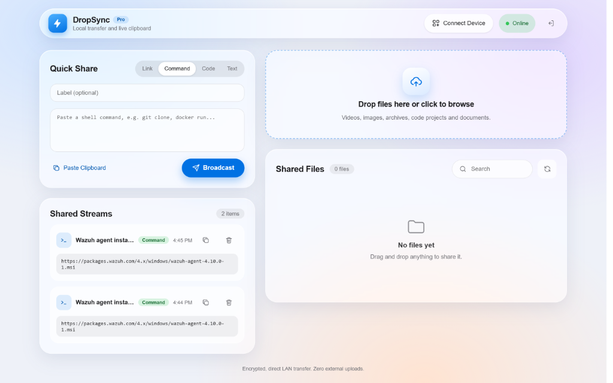

<div align="center">

  # ⚡ DropSync Pro
  ### Next-Gen Cross-Device Local Transfer & Live Clipboard Hub

  <p align="center">
    <b>High-Speed P2P LAN Transfer • Apple Liquid Glass UI • Instant QR Pairing • Zero Cloud Dependencies</b>
  </p>

  [](https://opensource.org/licenses/MIT)
  [](https://www.python.org/)
  [](https://fastapi.tiangolo.com)
  [](https://www.docker.com/)
  [](#-cross-device-compatibility)

  <br />

  

</div>

---

## 🌟 Why DropSync Pro?

Transferring files, videos, code blocks, or links between your **Windows PC, iPhone, Android, MacBook, or Linux workstation** usually means sending them to your own WhatsApp, uploading to Google Drive, or dealing with sluggish Bluetooth.

**DropSync Pro fixes that instantly:**
- 🚀 **Gigabit LAN Speeds**: Transfers happen directly over your local Wi-Fi router. Multi-gigabyte videos and archives transfer in seconds.
- 🎨 **Apple Liquid Glass Design**: Frosted glass cards, specular highlights, dynamic blur, and responsive mobile controls.
- 📱 **QR Code Instant Pairing**: Point your phone camera at the screen and you're immediately connected. No app install needed on phones.
- 📋 **Live Multi-Device Clipboard**: Copy text or commands on your PC; paste them immediately on your phone (and vice-versa).
- 🔒 **Local PIN Security**: Protects against unauthorized network access with tokenized sessions.
- 🌐 **100% Private**: Zero external servers, zero cloud tracking, zero data leakage.

---

## 💻 System Requirements

DropSync Pro runs smoothly on minimal hardware across all operating systems:

### 🖥️ Host Machine (Where server runs)
| OS | Minimum Version | Runtime Requirement | RAM & Storage |
|---|---|---|---|
| **Windows** | Windows 10 / 11 (64-bit) | Python 3.10+ or Docker | 256 MB RAM, 100 MB disk |
| **macOS** | macOS Monterey or newer (Intel / Apple Silicon) | Python 3.10+ or Docker | 256 MB RAM, 100 MB disk |
| **Linux** | Ubuntu, Debian, Fedora, Arch, Alpine | Python 3.10+ or Docker | 128 MB RAM, 100 MB disk |

### 📱 Client Devices (Connecting to share files)
| Device Type | Supported Systems | Requirements |
|---|---|---|
| **Smartphones** | iOS 14+ (iPhone), Android 8.0+ | Any modern browser (Safari, Chrome, Firefox) |
| **Laptops / Tablets** | iPadOS, ChromeOS, Windows, Mac | Any modern web browser |
| **Network** | Any local Wi-Fi, Ethernet LAN, or Hotspot | Both devices connected to the same network |

---

## 🚀 Quick Start Guide

### Option 1: Windows (1-Click Launch) 🪟

1. Clone or download this repository:
   ```bash
   git clone https://github.com/AbhijeetRON/DropSync-Pro.git
   cd DropSync-Pro
   ```
2. Double-click **`run.bat`** (or run `py app.py`).
3. Your browser will open **`http://localhost:8080`**.

---

### Option 2: Linux / macOS 🍏 🐧

```bash
git clone https://github.com/AbhijeetRON/DropSync-Pro.git
cd DropSync-Pro

# Install dependencies
pip install -r requirements.txt

# Run server
python3 app.py
```

---

### Option 3: Docker (Containerized) 🐳

```bash
# Build and run in background
docker compose up -d --build
```
Server runs at `http://<your-host-ip>:8080`.

---

## 📲 How to Connect Mobile Devices


1. Click the **"Connect Device"** button on the top right.
2. Scan the on-screen **QR Code** using your phone camera (or enter the displayed IP address like `http://192.168.1.X:8080`).
3. Enter your security PIN (**default:** `1234`).
4. You can now send photos, videos, clipboard text, and commands back and forth seamlessly!

---

## ⚙️ Configuration & Customization

You can customize port and security PIN using environment variables:

| Variable | Default | Description |
|---|---|---|
| `PORT` | `8080` | Port for the web portal |
| `REQUIRE_PIN` | `true` | Set to `false` to disable PIN authentication |
| `SHARE_PIN` | `1234` | Change to any custom password or PIN |

**Windows PowerShell:**
```powershell
$env:SHARE_PIN="9876"; py app.py
```

**Linux / Mac:**
```bash
SHARE_PIN="9876" PORT="9000" python3 app.py
```

---

## 🔒 Security Architecture

- **Tokenized Sessions**: Protected by HTTP-only cryptographic session cookies.
- **Path Traversal Protection**: Files are safely isolated inside `shared_data` directory.
- **Direct LAN Routing**: All packets remain inside your home/office network. No telemetry or external analytics.

---

## 🤝 Contributing

Contributions are welcome! Feel free to:
1. Star the repo 🌟
2. Open issues for feature requests 💡
3. Submit Pull Requests 🛠️

---

<div align="center">
  <sub>Built with ❤️ for ultra-fast and private local sharing.</sub>
</div>
